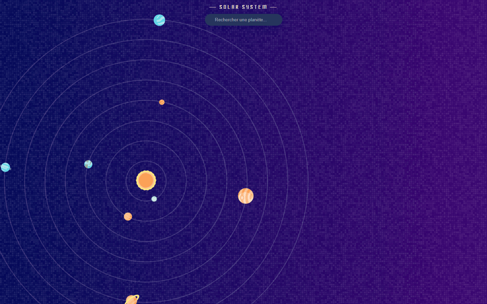
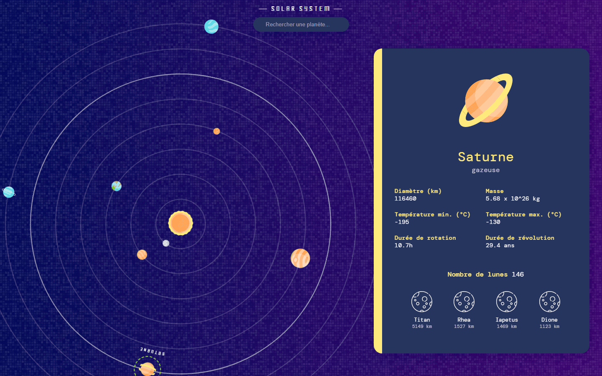
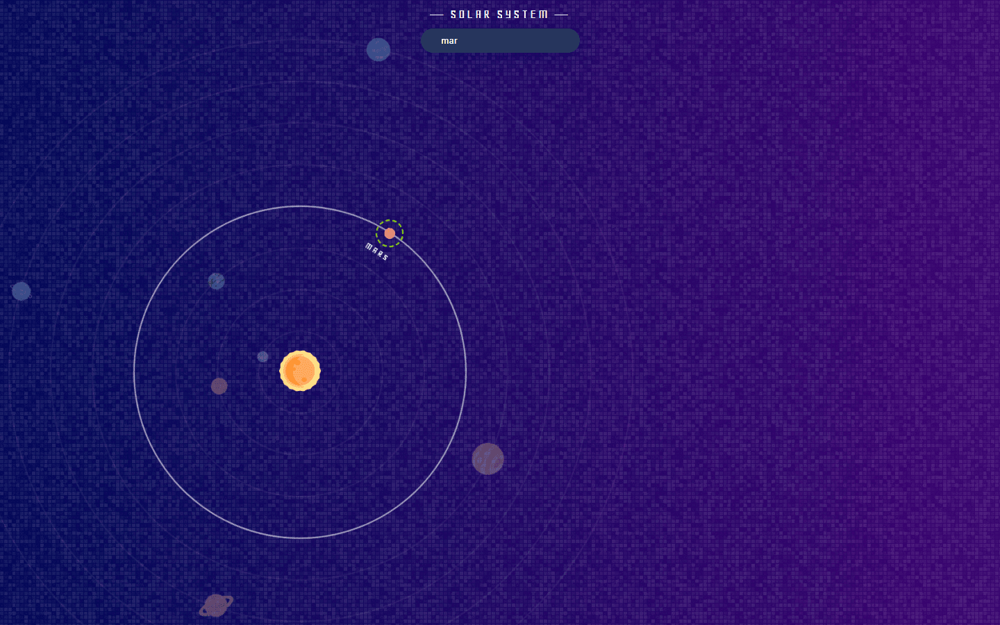

# Solar

An interactive solar system explorer — browse the eight planets, search
them by name, and open any one of them for its figures and its moons.

**[Live demo](https://solorush-solar.netlify.app/)**

<p align="center">
  
  
  
</p>

## Why

A two-day solo sprint, built to see how far a small front-end could go
with no back-end and no component library: local data, hand-written SASS,
and animation doing the work that a 3D library would usually do.

## Features

- **The eight planets**, each with diameter, mass, distance from the Sun,
  temperature range, rotation and revolution periods, moon count and rings.
- **Moons**, listed on the planets that have them.
- **Search by name**, filtering the system live.
- **Planet cards** that open on click and close on Escape or on a click
  outside — no modal library.
- **Animation** on the planets and on the transitions between states.

## Stack

React, TypeScript, Vite, SASS (CSS modules plus a shared style layer).
No back-end, no API: the data ships with the app as JSON.

## Running it locally

Requires Node 20+.

```bash
git clone https://github.com/fredericbriand/solorush-solar.git
cd solorush-solar
npm install
npm run dev
```

```bash
npm run lint    # ESLint
npm run build   # type check + production build
```

## How it works

**The data is a file, not a service.** Eight planets, twelve fields each,
in `src/data/planets.json`, with their moons nested. Display labels live
in a separate `labels.json`, so the field names in the data never have to
double as user-facing text.

**Styling is layered.** A shared `styles/` directory holds variables,
mixins, colours, fonts, reset and animations; each component then owns a
`.module.scss` beside it. Component styles can't leak, and the shared
layer stays the single place where a decision is made.

**Closing a card is handled by the app, not by a library.** Escape and
click-outside are bound once, in an effect, and cleaned up on unmount.

## Status

Two-day solo sprint, June 2026. Not actively maintained.
